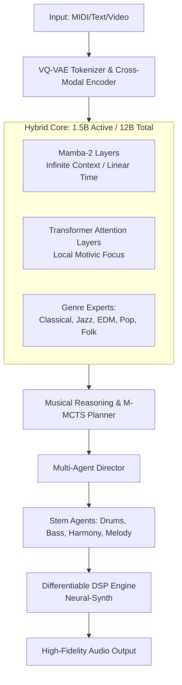

# Project Neuro-Symphony: Specification for a Frontier Small Music LLM (2026 SOTA)

**Version:** 1.0.0  
**Date:** October 2026  
**Model Size Target:** 1.5B Active Parameters (12B Total via MoE)  
**Objective:** To build a highly efficient, state-of-the-art music generation model that transitions from pattern-mimicry to true musical intelligence, incorporating unsupervised representation learning, System 2 reasoning, differentiable audio synthesis, and multi-genre agentic orchestration.

---

## 1. Architectural Overview

To achieve SOTA performance in a small footprint, the model uses a **Hybrid Sparse Mixture-of-Experts (MoE) Architecture**, combining the efficiency of State Space Models (SSMs) with the expressivity of Transformers, bypassing raw audio generation via **Differentiable DSP**.



### 1.1 Core Tokenization & Lexicon
*   **VQ-VAE "Musical Lexicon":** Instead of relying solely on human MIDI standards, the model uses a Vector Quantized Variational Autoencoder to discover its own discrete musical primitives directly from unlabeled data, creating a highly efficient, learned codebook of musical "words."
*   **Cross-Modal Conditioning:** Accepts text prompts (genre, mood), MIDI input, and video embeddings (via a frozen ViT) for cinematic synchronization.

### 1.2 Hybrid SSM-Transformer MoE
*   **Base Dimension:** 1024
*   **Layers:** 24 (Alternating Mamba-2 and Transformer Attention)
*   **MoE Configuration:** 8 Genre-Specific Experts (e.g., Classical, Jazz, EDM, Pop) with 2 active experts per token, routed dynamically via a learned genre vector.
*   **Infinite Context (Ring Attention):** Enables processing of 10+ minute pieces without memory bottlenecks by passing compressed recurrent memory tokens between 4-bar blocks.

### 1.3 The Differentiable DSP "Neural-Synth"
To avoid the computational cost of latent audio diffusion, the LLM outputs symbolic MIDI alongside **Synth Macro Parameters** (oscillator type, filter cutoff, ADSR, FX sends). These are passed through a fully differentiable synthesizer (`torchsynth`), allowing end-to-end gradient descent directly on the audio waveform while retaining symbolic control.

---

## 2. Training Pipeline: The 4-Phase Frontier Stack

This pipeline moves from unsupervised foundation building to agentic self-play.

```mermaid
timeline
    title Neuro-Symphony Training Pipeline
    section Phase 1: Unsupervised Foundation
        A-JEPA Audio Pretraining : Predict latent representations of masked audio
        VQ-VAE Lexicon Discovery : Learn discrete musical codebook
    section Phase 2: Multi-Genre & Agentic SFT
        Genre MoE Training : Train experts on balanced genre datasets
        Multi-Agent Orchestration : Train Director & Stem agents
        Differentiable DSP Tuning : Optimize Neural-Synth parameters
    section Phase 3: Aesthetic Alignment (DPO)
        2D Reward Model : Train on Valence/Arousal human preferences
        Direct Preference Optimization : Align model to emotional targets
    section Phase 4: System 2 & Self-Play
        M-MCTS Integration : Implement test-time search
        AlphaGo-Style Self-Play : Composer vs. Critic synthetic data generation
```

### 2.1 Phase 1: Unsupervised Foundation
*   **A-JEPA (Audio Joint-Embedding Predictive Architecture):** The model is trained on vast unlabeled audio. It masks 2-second chunks and predicts the *latent representation* of the missing audio, forcing it to learn the physics and grammar of music rather than reconstructing noise.

### 2.2 Phase 2: Supervised & Agentic Fine-Tuning
*   **Genre-Aware Theory Constraints:** A differentiable layer penalizes generations violating genre-specific rules (e.g., strict 16th grid for EDM, fluid voice leading for Classical).
*   **Agentic Multi-Stem Training:** The "Director" LLM generates a structural plan (key, tempo, chord progression). Sub-agents (Drums, Bass, Harmony, Melody) generate stems conditionally, sharing a context memory.

### 2.3 Phase 3: Aesthetic Alignment (DPO)
*   **2D Emotion Reward Model:** A model trained on human feedback outputs a 2D vector: **Valence** (Happy/Sad) and **Arousal** (Calm/Energetic).
*   **Direct Preference Optimization (DPO):** Fine-tunes the LLM so that prompts like `<mood:melancholic>` reliably produce music mapping to the bottom-left quadrant of the emotion circumplex.

### 2.4 Phase 4: System 2 Search & Self-Play
*   **Musical MCTS (M-MCTS):** At inference, the model uses Monte Carlo Tree Search to simulate multiple musical continuations, evaluating them with the Aesthetic Reward Model before committing to the best path.
*   **Self-Play Loop:** A Composer agent generates music; a Critic agent tries to find flaws. Flawless generations are added back to the training set as synthetic data, allowing the model to surpass human data limitations.

---

## 3. The "Neuro-Symphonic Studio" Visualization Dashboard

A state-of-the-art model requires state-of-the-art interpretability. The training and inference dashboard includes:

| Visualization Component | Purpose & Insight |
| :--- | :--- |
| **Codebook Galaxy (UMAP)** | Visualizes the VQ-VAE learned lexicon. Hovering over points plays the acoustic rendering of that learned token, revealing emergent musical concepts. |
| **River of Time (3D Memory)** | Tracks the Infinite Context memory tokens over a 10-minute generation. Shows when past motifs are "remembered" and influence the present. |
| **Thought Tree (M-MCTS)** | A branching graph showing the model's test-time reasoning. Clicking discarded branches reveals *why* they were rejected (e.g., "Parallel fifths detected"). |
| **Aesthetic Circumplex** | A 2D Valence/Arousal scatter plot tracking DPO alignment. Ensures the model doesn't suffer "aesthetic collapse" (becoming emotionally neutral). |
| **Neural-Synth Signal Flow** | An animated modular synth diagram showing how LLM-generated parameters alter the audio signal path in real-time. |
| **Emergent Genre Dendrogram** | An unsupervised hierarchical tree showing how the model organizes music styles without human labels, revealing novel sub-genres. |

---

## 4. Evaluation: "Humanity's Last Exam" for Music

Standard metrics (loss, perplexity) are insufficient. The model is evaluated against the 2026 frontier benchmarks adapted for audio:

1.  **Genre Authenticity Blind A/B Test:** Human experts choose between human-made and AI-made tracks for specific genres.
2.  **Cross-Genre Style Transfer:** Convert a Classical melody to EDM without altering the core notes. Scored on theory compliance + human rating.
3.  **Structural Coherence Benchmark:** Generate a 5-minute piece with ABA form. Evaluated by automated structural segmentation algorithms.
4.  **Micro-Timing Groove Test:** Does the Jazz generation swing? Is the EDM perfectly quantized? Analyzed via onset detection statistics.
5.  **Video-to-Music Sync Score:** Does the generated music hit frame-accurate scene cuts? Evaluated via cross-correlation of visual motion vectors and audio onsets.

---

## 5. System Requirements & Deployment

*   **Training Hardware:** 8x H100 GPUs (80GB) for 14 days. The hybrid SSM architecture and MoE sparsity keep memory and compute requirements manageable for a small model.
*   **Inference Latency:** 
    *   *Standard Generation:* <50ms per token.
    *   *Real-Time Co-Creation (Speculative Decoding):* <20ms audio buffer latency.
    *   *System 2 (M-MCTS):* 1-2 seconds per 4-bar phrase (acceptable for studio composition, not live playback).
*   **Framework:** PyTorch 2.6 with `torch.compile`, Mamba-SSM CUDA kernels, and `torchsynth` for differentiable DSP.

## 6. Conclusion

This specification outlines a **1.5B active parameter model** that leverages every frontier advancement discussed: it learns the physics of sound via A-JEPA, discovers its own vocabulary via VQ-VAE, reasons about structure via M-MCTS, produces audio via Differentiable DSP, and aligns with human emotion via DPO. It is not merely a pattern generator, but an agentic, self-improving musical intelligence.